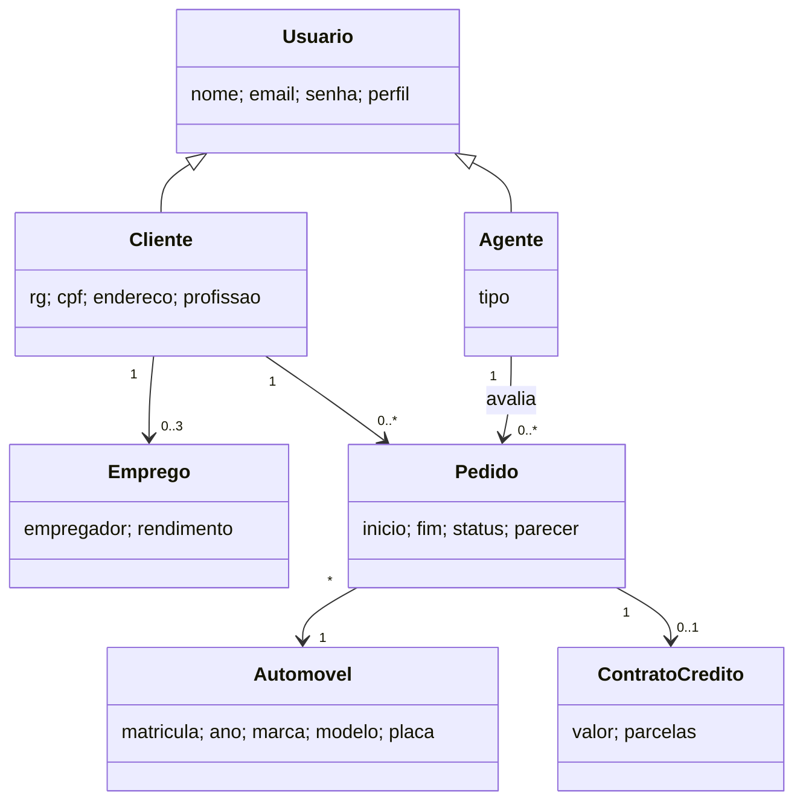

# Modelo inicial — versão 1

Esta versão registra a análise de requisitos antes das decisões de implementação.

## Ajustes necessários após a implementação

- Os perfis foram representados por um campo em `usuarios`, evitando herança entre tabelas.
- O cadastro de clientes foi separado em `clientes` e `empregos`.
- O status ganhou transições explícitas e o crédito ficou associado a banco e pedido.
