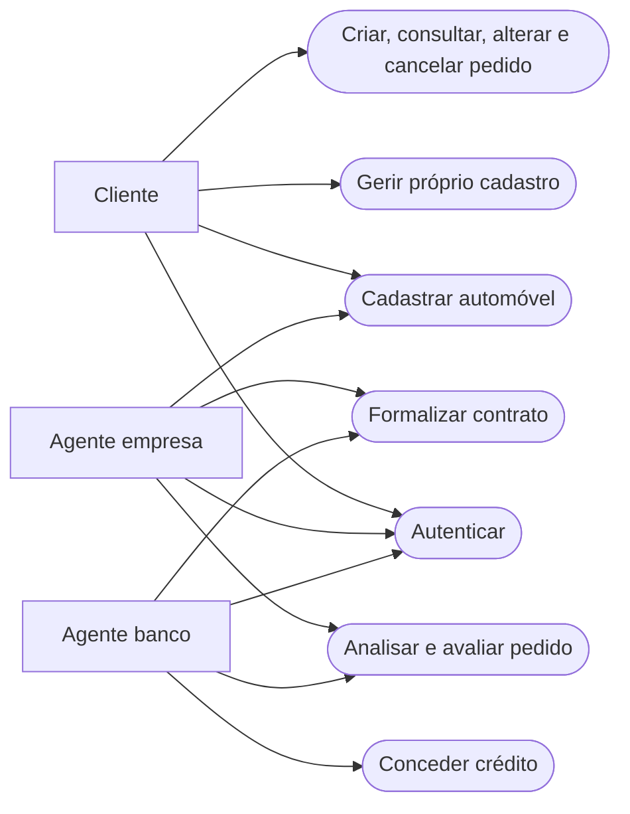
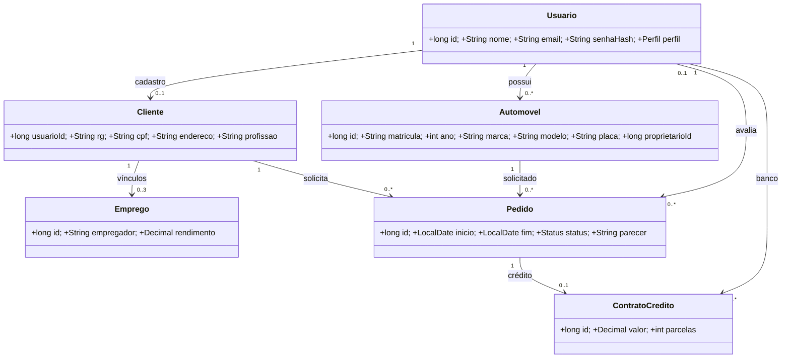
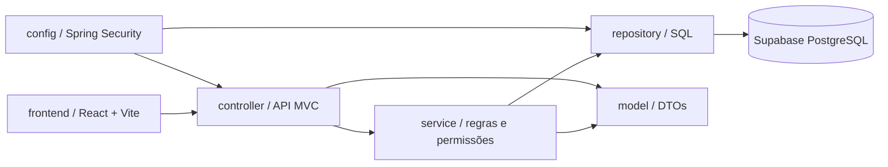
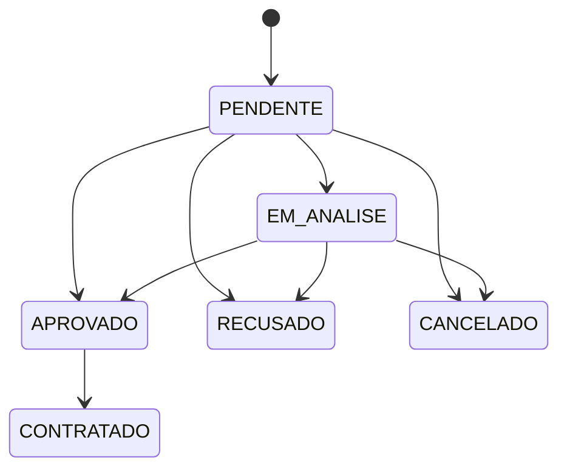

# Modelo atualizado — versão 2

## Casos de uso

## Diagrama de classes / dados

## Diagrama de pacotes / visão lógica

## Estados do pedido

O código usa `usuarios.perfil` para CLIENTE, EMPRESA e BANCO. O backend valida cada transição; o frontend apenas oferece os botões correspondentes.
